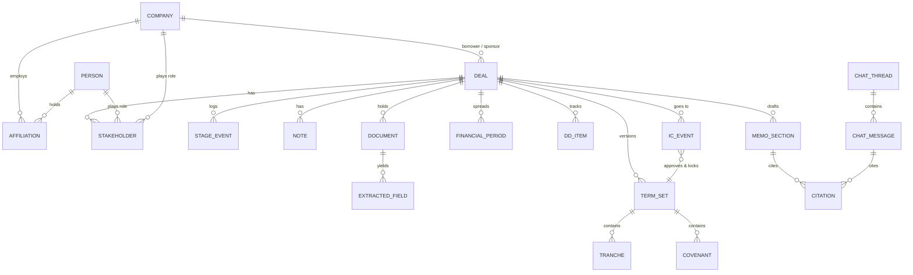

# Private credit underwriting app: product scope v3

*Revision 3. This version takes your page and navigation structure (top nav with search and sign-in; left nav with New, Chat, Deals, Companies, People; New → modal → detail page; /deals list and kanban; tabbed detail pages) and fills it in. It draws on the v1 research (workflow, personas, competitors, data model), the v2 MVP and Ideal State split, the Soal Labs principles, and how leading tools in this space work. Each item is tagged **MVP** (the demo prototype) or **Ideal** (the full product).*

## Summary

The app has three kinds of record: **Deals, Companies and People**. They share one shell: a top nav with global search and sign-in, and a left nav with **New, Chat, Deals, Companies, People**. Every record has a list page and a tabbed detail page at `/[object]/[id]/[tab]`. The **deal page carries the underwriting work**, with ten tabs covering every stage from sourcing to IC approval. **Chat** answers questions across the whole database by running structured queries and citing what it used, rather than searching raw files. The design choices from v2 still hold:
- the versioned **term set** is the deal's single record of its terms;
- AI-extracted values wait for a person to confirm them;
- every number in a memo links back to its source;
- IC approval locks the approved terms.

The new structure adds the relationship side (companies, people, activity) that deal CRMs handle well. It also adds the controls that credit teams expect: duplicate checks on create, rules on which stage moves are allowed, an audit trail, permissions, and walls around non-public information.

## 1. Information architecture

### Routes

| Route | What it is | Phase |
|---|---|---|
| `/login` | Sign-in | MVP (mock), Ideal (SSO) |
| `/` | Redirects to `/deals` (Ideal: a "Home / My queue" page) | MVP |
| `/chat`, `/chat/[thread_id]` | Chat across the whole database, with saved threads | MVP |
| `/deals` | Every deal; switch between `?view=list` and `?view=pipeline` | MVP |
| `/deals/[deal_id]/[tab]` | Deal detail; the tab defaults to `overview` | MVP |
| `/companies`, `/companies/[company_id]/[tab]` | Company list and detail (borrowers, sponsors, lenders, advisors) | MVP |
| `/people`, `/people/[person_id]/[tab]` | People list and detail | MVP |
| `/deals/[deal_id]/memo/[memo_id]` | Full-screen memo editor (opens from the IC Memo tab) | Ideal |
| `/settings/*` | Profile, users and roles, templates, stages, integrations, audit log | Ideal |

Putting the tab in the URL means any tab can be shared as a link or bookmarked. It also lets chat answers and search results link straight to the right place.

### Shell

```
┌──────────────────────────────────────────────────────────────────────────┐
│ ▣ Logo   [ 🔍 Search deals, companies, people, documents…   ⌘K ]   🔔  (JR)▾ │  ← top nav
├───────────────┬──────────────────────────────────────────────────────────┤
│ ＋ New      ▾ │                                                          │
│   · Deal      │                                                          │
│   · Company   │                 page content                             │
│   · Person    │                                                          │
│ 💬 Chat       │                                                          │
│ ◫ Deals       │                                                          │
│ ▦ Companies   │                                                          │
│ ☺ People      │                                                          │
│ ───────────── │                                                          │
│ (Ideal) My queue · IC calendar · Review queue · Settings                 │
└───────────────┴──────────────────────────────────────────────────────────┘
```

The five items you specified stay as the primary nav. The Ideal state adds a small secondary group below a divider:
- **My queue:** my reviews, sign-offs and tasks.
- **IC calendar:** upcoming committees and their agendas.
- **Review queue:** extraction and duplicate decisions waiting on a person (Soal's review studio).
- **Settings.**

These come from v1's ranked views (#10 My queue, #8 IC event, #14 review studio). Without a home they would be scattered across deal pages.

## 2. Global elements

### Top nav: search

| Capability | MVP | Ideal |
|---|---|---|
| Command palette (`⌘K`) plus a search box in the top bar | ✔ | ✔ |
| Results grouped by type (Deals, Companies, People), each showing key context such as stage, sector or title | ✔ | ✔ |
| Fuzzy matching on names; recent items shown when the box is empty | ✔ (in-memory fuzzy match over seed data) | Server-side search index |
| Matches company aliases ("GS" → Goldman Sachs Group; project codenames → borrower) | Seeded aliases | The entity-resolution table (Soal's `EntityAlias`) |
| Searches inside documents, memos and notes, with snippet and page | — | ✔ |
| Actions from the palette ("New deal", "Go to Project Larch → Terms", "Ask chat…") | ✔ basic | ✔ |
| Results filtered by the user's permissions and information walls | — | ✔ (required) |

### Top nav: authentication and access

| Capability | MVP | Ideal |
|---|---|---|
| Sign-in page | Mock email login | SSO (Okta or Microsoft Entra ID) with MFA |
| User menu: profile, role, sign out | ✔ plus a **persona switcher** (Analyst, VP, IC member) for the demo | ✔ |
| Role-based permissions (e.g. only IC members record decisions; only the deal team edits terms) | ✔ a few rules, to show the idea | Full role model with per-deal teams |
| **Information walls.** Deal access is restricted for teams that hold MNPI. Wall-crossings are logged with approval, what was disclosed, and the recipient's acknowledgement. Conflict checks run before joining a deal ([FinTech Global, Sep 2026](https://fintech.global/2026/09/25/deal-room-compliance-why-mnpi-controls-cant-wait/)) | — | ✔ (essential for credit managers that also trade public credit) |
| AI follows the same permissions and walls (this is how DealCloud's Celeste works: [Intapp](https://www.intapp.com/dealcloud-ai-private-capital/)) | n/a | ✔ chat, search and duplicate flags never reveal records a user can't see |
| Audit log of logins, views of sensitive records, and exports | Actions only | ✔ |

### New → modal → detail page

One pattern covers all three record types:
1. Open a short modal that asks only for what's required.
2. Check for duplicates as the user types (DealCloud's Celeste does this; Soal's entity resolution is the same idea).
3. Create the record, log it as activity, and **redirect to `/[object]/[id]/overview`**.
4. Show a "complete this record" checklist on the Overview tab, so the modal stays short and the record gets filled in afterwards.

| Modal | Required fields | Optional fields | Smart behavior |
|---|---|---|---|
| **New Deal** | Deal name (or project codename); borrower (choose an existing company or create one inline); strategy {cash-flow DL, ABL/ABF, NAV, special sits} | Sponsor (company), deal type {LBO, add-on, refi, recap, growth}, source (banker or sponsor person), requested size, expected close, deal lead | **"Start from a CIM"**: drop in a PDF, and AI pre-fills the name, borrower, sector and headline financials as *proposed* values (Soal's intake-app pattern; Ideal; seeded in the MVP). The deal is created at stage **Sourced**, with the creator as lead. |
| **New Company** | Name; type {borrower, sponsor, lender, advisor, law firm, QoE provider, agent} | Website or domain, sector (GICS/NAICS), headquarters country, parent company | Checks for duplicates by name or alias and by domain ("Did you mean *Goldman Sachs Group, Inc.*?") |
| **New Person** | Full name; company (choose or create inline) | Email, title, phone, person type {management, sponsor, banker, advisor, lender, internal}, relationship owner | Checks for duplicates by email and by name + company. Creates the person's first company link (an *Affiliation*, so role history can be tracked). |

## 3. Views

### 3.1 `/deals`: every deal, as a list or a pipeline

**List view (the default)**
- **Columns:** deal, borrower, sponsor, stage, days in stage, strategy, requested size, fund hold, leverage, pricing (spread), risk rating, lead, next IC date, last activity.
- **Behavior:** sort by any column; filter by stage, strategy, sector, sponsor, lead, size range and date; quick-filter chips ("My deals", "At IC this month", "Passed last 90 days").
- **Saved views:** personal and shared.
- **Bulk actions:** reassign, add a tag. Ideal adds Excel export.

**Pipeline (kanban) view**
- **Columns:** **Sourced → Screening → Term Sheet → Diligence → IC → Documentation → Closed**, plus a collapsed **Passed / Lost / On hold** lane. These come from v1's eight-stage model, with "handed off" kept as a status of Closed.
- **Cards:** deal name, borrower, size, lead's avatar, days-in-stage badge (amber when stale), and red-flag count.
- **Column header:** deal count and total requested dollars.
- **Drag and drop changes the stage**, with **gates on the move**:

| Moving into… | Gate (MVP: soft warning, can be overridden with a reason; Ideal: firm-configurable, hard or soft) |
|---|---|
| Screening | Borrower and strategy are set |
| Term Sheet | Screening memo exists; term set v1 has been drafted |
| IC | IC memo marked "ready for IC"; no red-flag finding without a mitigant |
| Documentation | The IC decision is Approve or Approve with conditions (this locks the term set) |
| Closed | Pre-close conditions satisfied; KYC cleared |
| Passed / Lost | **Reason code required** (pricing, structure, credit quality, sponsor, lost to competitor, other) plus a note |

Every stage change writes a StageEvent, which feeds the History tab and pipeline analytics.

Reason codes matter. Fewer than 3% of reviewed deals close (v1, from Carlyle's TCG BDC filing), so the deals a fund passes on are a large share of its history. They need to stay searchable for precedents.

### 3.2 `/deals/[deal_id]`: the underwriting workspace

**Header (always visible)**
- Deal name, borrower, sponsor, strategy chip and a **stage stepper**.
- **Key figures:** facility size and hold, leverage at close, spread and floor, covenant cushion, risk rating, next IC date. This follows Attio's highlights pattern ([Attio](https://attio.com/help/reference/managing-your-data/records/configure-record-pages.md)). Each figure is computed from confirmed data and shows amber when a value is stale or still unreviewed.
- **Actions:** Advance stage · Generate memo · Submit to IC · Ask chat about this deal · ⋯
- **Ideal:** a "chat about this deal" side panel that opens on any tab, scoped to this deal.

**Tabs** (yours in **bold**; additions are carried over from v1 and v2):

| # | Tab | Contents | Key actions | Phase |
|---|---|---|---|---|
| 1 | **Overview** | Deal summary and thesis; key figures; stage checklist ("what's needed for the next gate"); open diligence red flags; IC conditions; team; recent activity; "complete this record" prompts | Edit summary, assign team, advance stage | MVP |
| 2 | **Financials** | **Extraction review**: source page next to the extracted fields, with confidence scores and Confirm or Correct (from v2 / Soal). Spreads by period and case (actual, sponsor, lender base, downside). Derived leverage, interest coverage, fixed-charge coverage and liquidity | Confirm or correct a field; choose the source of truth (e.g. QoE over CIM); add a case | MVP (one period set + extraction review); Ideal (full spreading and cases, Excel round-trip) |
| 3 | Terms & Structure *(the "Securities")* | Term-set version picker and side-by-side comparison; facility and tranche table (instrument, commitment, hold, rate, spread, floor, OID, PIK, call protection, maturity, amortization); fees; covenants with **headroom bars** against the lender case; sources & uses; capital structure | Edit terms; save a version; compare v1 and v2; lock (only through an IC decision) | MVP (tranches, one covenant, versions); Ideal (fees, margin grids, covenant designer, unitranche lender agreements) |
| 4 | Due Diligence | Workstreams (QoE, commercial, legal, tax, insurance, environmental, IT, background, KYC/AML, collateral/field exam, lien searches); request lists; **findings** with severity and mitigant; third-party reports | Add a request or finding; link to a memo section; **turn a finding into an IC condition** | MVP (findings list + conversion); Ideal (request lists synced from the data room, advisor access) |
| 5 | **IC Memo** | Memo versions by type (screening, diligence update, final, closing); sections with citation chips, *stale* flags, and AI or human authorship; reviewer sign-off per section; **"show the data" drawer** (queries + records behind each section) | Generate or regenerate a section; edit; request review; mark "ready for IC"; export to Word or PDF | MVP (final memo, one template, generated in advance with an optional live regenerate); Ideal (firm templates, export, track changes) |
| 6 | IC & Approvals | IC events (screening, diligence update, final); packet; Q&A log; votes; decision; conditions with owner, due date and evidence; **precedents and devil's-advocate questions** (Soal's IC Insights Engine) | Submit to IC; record votes and the decision; satisfy a condition | MVP (one event, decision, lock, precedent panel); Ideal (quorum rules, delegated authority, IC calendar) |
| 7 | **Stakeholders** | People and companies on the deal, by role: borrower management, sponsor team, bankers, counsel (lender and borrower), QoE provider, agent, co-lenders; plus the internal deal team. Each shows relationship strength and last touch | Add a stakeholder (existing record or New Person/Company inline); set role | MVP |
| 8 | Documents | Every file, with type (CIM, model, QoE, term sheet, credit agreement…), version, source (upload, data room, email), extraction status, and where it is cited | Upload; open in viewer; re-run extraction | MVP (list + viewer); Ideal (data-room sync, version chains, duplicate collapse) |
| 9 | **Deal Notes** | Rich-text notes (meeting notes, calls, screening thoughts) with @mentions of people, companies and deals; tagged by type; pinned notes | Add a note; @mention; pin; (Ideal) save a chat answer as a note | MVP |
| 10 | **History** | Unified timeline: stage changes, term-set versions, field confirmations and corrections, memo versions, IC decisions, notes, documents; filter by type or user; "what changed since the last IC" | Filter; jump to the record | MVP (AuditEvent + StageEvent feed) |
| — | Ideal adds: Closing (conditions precedent, KYC, approved-vs-closing comparison, closing memo), Monitoring handoff (push the package to WSO, Allvue or Chronograph), Tasks | | | Ideal |

The tab order follows the deal lifecycle, with Overview first and History last. Firms can reorder or hide tabs per strategy, as Attio allows per record type.

### 3.3 `/companies` and `/companies/[company_id]`

**List.** Columns: name, type, sector, headquarters, number of deals with us (active, closed, passed), total committed, last activity, relationship owner. Filter by type, so the same page serves as the **sponsor list** and the **borrower list**.

**Detail header:** name, logo or domain, type chips (a company can be both a borrower and a portfolio company), sector, key figures, owner.

| Tab | Borrower / portfolio company | Sponsor | Phase |
|---|---|---|---|
| Overview | Description; latest confirmed financials (revenue, EBITDA, leverage); current exposure; risk rating | Fund and strategy; **track record with us** (deals shown, closed, passed, pricing history); sponsor tier | MVP |
| Related Deals | Every deal where the company is borrower, sponsor, lender or advisor, with role and outcome | Same | MVP |
| People | Current and past affiliates, with titles and dates (from the Affiliation history) | Deal professionals at the sponsor | MVP |
| Financials | Period history across deals, with source and confidence | — | Ideal |
| Documents | Files across all related deals | Same | Ideal |
| Activity | Meetings, emails, notes, calls involving the company's people | Same | MVP (notes only); Ideal (captured from email and calendar) |
| Notes | Company-level notes | Same | MVP |

### 3.4 `/people` and `/people/[person_id]`

**List.** Columns: name, title, current company, person type, relationship strength, last interaction, relationship owner, number of related deals. Filter by type (management, sponsor, banker, advisor), by company and by strength.

**Detail header:** name, current title @ company, contact details, relationship strength (Ideal: computed from interaction frequency and recency, Affinity's "relationship intelligence" model: [Affinity](https://www.affinity.co/solution-briefs/the-relationship-intelligence-platform-for-private-capital)), owner, "who on our team knows them best."

| Tab | Contents | Phase |
|---|---|---|
| **Activity** | Timeline of notes, meetings, calls and emails involving the person, plus the deals they introduced | MVP (notes and stakeholder events); Ideal (automatic email and calendar capture) |
| **Related Deals** | Deals where they are a stakeholder, with their role (e.g. "Sponsor deal lead", "Borrower CFO", "Banker – sell-side") and the deal outcome | MVP |
| **Related Companies** | **Role history** as Affiliations (e.g. "CFO at Company A 2019–22 → CEO at Company B 2023–"), current and past; Soal's entity resolution example | MVP |
| Overview | Bio, contact details, key facts, relationship summary, sectors of expertise | MVP |
| Notes | Person-level notes | MVP |

### 3.5 `/chat`: questions across the whole database

**Layout.** A list of saved threads on the left; the conversation in the center; a composer with **@mentions** to scope a question to a deal, company or person, plus suggested prompts. Ideal adds a right-hand "sources" panel.

**How it works.** This is Soal's "extract first, then query" approach applied to chat. The model answers by **calling typed query tools over the operational database**, which become an MCP server in the Ideal state. Examples:
- `search_entities`, `list_deals(filters)`, `get_deal`
- `get_term_set(deal, version)`, `get_financials(company, period)`
- `get_findings(deal, severity)`, `get_memo_section`
- `get_activity(person|company)`, `get_precedents(criteria)`
- (Ideal) `search_documents` for full-text questions

Answers include:
- **Citation chips** on every figure, linking to the record, tab or document page.
- Tables when the answer is tabular.
- A **"show queries" disclosure** listing the tool calls behind the answer.
- Actions: *Save to deal notes*, *Insert into memo section* (Ideal), *Open in /deals with these filters*.

**Guardrails.** Answers come from the firm's own data only (web off by default). The same permissions and walls apply. If the data isn't there, chat says "not in the database" rather than guessing.

**Example prompts**

| Prompt | Data it touches |
|---|---|
| "What spreads and leverage did we approve on sponsor-backed services deals over $50M EBITDA in the last 2 years?" | Deals, ICEvents, TermSets |
| "Which deals in Diligence have unresolved red flags?" | Deals, DDItems |
| "Who do we know at [sponsor], and which of their deals have we passed on and why?" | People, Affiliations, Deals (passed reasons) |
| "Summarize what changed on Project Larch since screening IC." | AuditEvents, TermSet versions |
| "Find precedents for Larch and the questions IC asked on them." | Precedents, IC Q&A |

| Capability | MVP | Ideal |
|---|---|---|
| Thread UI, @mentions, suggested prompts | ✔ | ✔ |
| Live Claude tool calls over the seed data (serverless function) | ✔ (with scripted fallback answers for 4–5 prompts so the demo can't fail) | ✔ MCP server over Postgres |
| Citations and "show queries" | ✔ | ✔ |
| Search inside documents | — | ✔ |
| Write actions (log a note, update a field) with a confirmation step | — | ✔ (draft → user confirms, as Celeste's agents do) |

## 4. Data model v3

The relationship layer is new: Company, Person, Affiliation, Stakeholder, Note, Activity, Chat. The underwriting core is unchanged from v2.

| Entity | Key fields | Relationships | Phase |
|---|---|---|---|
| **User** | name, email, role {analyst, associate, VP, MD, IC member, PM, compliance, admin}, sso_id | Deal team, IC votes, authorship | MVP |
| **Company** | name, aliases[], domain, types[] {borrower, sponsor, lender, advisor, law_firm, QoE, agent}, sector, hq_country, parent_id, owner_user_id | ↔ Deal (via Stakeholder), ↔ Person (via Affiliation) | MVP |
| **Person** | full_name, email, phone, person_type, relationship_owner_id, relationship_strength (derived) | ↔ Company (Affiliation), ↔ Deal (Stakeholder) | MVP |
| **Affiliation** | person_id, company_id, title, start_date, end_date, is_current | Role history | MVP |
| **Deal** | name, codename, borrower_company_id, sponsor_company_id, strategy, deal_type, stage, status, pass_reason, requested_size, fund_hold_target, expected_close, lead_user_id, risk_rating + rating_scale | Center of the model | MVP |
| **Stakeholder** | deal_id, person_id or company_id, role (e.g. borrower CFO, sponsor lead, lender counsel), side {internal, borrower, sponsor, lender, advisor} | Joins Deal to Person/Company | MVP |
| **StageEvent** | deal_id, from_stage, to_stage, user_id, at, gate_overrides, reason | Feeds History and pipeline analytics | MVP |
| **Note** | body (rich text), type {meeting, call, screening, IC, general}, author_id, pinned, mentions[] (polymorphic) | Attached to a Deal, Company or Person | MVP |
| **Activity** | type {note, meeting, email, call, stage_change, doc_upload…}, actor, at, subject_refs[] | Unified timeline across records | MVP (derived); Ideal (captured) |
| **Document** | deal_id, type, title, version, source, pages, hash, extraction_status | Cited by memos; yields extracted fields | MVP |
| **ExtractedField** | document_id, deal_id, field_key, value, unit, period, confidence, page, status {proposed, confirmed, corrected}, reviewed_by | AI proposes; a person confirms | MVP |
| **TermSet** | deal_id, version, label {proposal, term_sheet, IC_approved, closing}, status {draft, locked}, parent_id | → Facility / Tranche / Covenant | MVP |
| **Tranche** *(security)* | term_set_id, instrument, lien_rank, commitment, hold, base_rate, spread_bps, floor_bps, oid_pct, pik_bps, call_protection, maturity, amort_pct | Facility is added in Ideal | MVP |
| **Covenant** | term_set_id, class, metric, operator, levels (JSON steps), test_freq, cushion_pct (derived) | | MVP |
| **FinancialPeriod** | company_id, deal_id, period_end, period_type, case, source, revenue, adj_EBITDA, addbacks, debt, cash, interest | Derived ratios | MVP (one set) |
| **DDItem** | deal_id, workstream, kind {request, finding}, severity, status, mitigant, memo_section_key, ic_condition_id | | MVP |
| **Memo / MemoSection** | memo_type, version, status; section_key, content, generated_by, stale, reviewed_by | → Citation | MVP |
| **Citation** | section_id or chat_message_id, target_type {extracted_field, tranche, covenant, dd_item, document_page, record}, target_id, label | Shared by memos **and chat** | MVP |
| **ICEvent / ICVote / ICCondition** | stage, date, term_set_id, decision; vote; condition (owner, due, status, evidence) | Approval locks the TermSet | MVP (votes and conditions as JSON) |
| **ChatThread / ChatMessage** | owner, title, scope_refs[]; role, content, tool_calls (JSON), citations | | MVP |
| **AuditEvent** | actor, action, entity, field, before, after, at | Feeds History; compliance | MVP |
| Ideal additions | Facility, Fee, CallProtectionStep, MarginGridRow, CovenantLevelStep, EBITDAAddbackRule, Scenario, ReturnMetric, DDWorkstream, ThirdPartyReport, Committee, ApprovalAuthority, MemoTemplate, EntityAlias, DocumentVersion, InfoBarrier / WallCrossing, Task, Collateral / BorrowingBase (ABL/NAV), IntercreditorAgreement, FundAllocation, RiskRating scale, KYCRecord | | Ideal |



**Rules** (carried over and extended):
1. Numbers shown anywhere are computed from confirmed records; they are never typed into a memo.
2. Term sets are copy-on-write and locked by an IC approval.
3. Every write creates an AuditEvent, which is what the History tab shows.
4. Ratings are stored with their scale.
5. Duplicate checks run before any Company or Person is created.
6. Notes, Activity and Citations are *polymorphic*: one table each that can point at a deal, company or person.

## 5. Gold-standard practices built into the scope

| Practice | Source of the pattern | Where it appears |
|---|---|---|
| AI proposes, a person confirms; confidence scores; source shown alongside | Soal Context Layers / review studio | Financials tab, "Start from a CIM", Review queue |
| Citations on every AI-generated number; "show the queries" | Soal (MCP pattern); Hebbia, Brightwave (v1) | IC Memo tab, Chat |
| One versioned term set; approved terms locked; approved-vs-closing comparison | v1 analysis (the gap no competitor covers) | Terms tab, IC & Approvals, Closing |
| Duplicate checks on create; alias resolution | DealCloud Celeste; Soal entity resolution | New modals, Search |
| Key-figure highlights; configurable tabs; relationship tabs | Attio record pages | All detail pages |
| Relationship strength; automatic activity capture | Affinity | People, Companies, Stakeholders |
| AI follows permissions and information walls | DealCloud Celeste | Chat, Search |
| Wall-crossing log, conflict checks, access audit | MNPI control guidance (FinTech Global 2026) | Auth / Settings (Ideal) |
| Reason codes on passed deals; searchable dead deals | <3% conversion (TCG BDC filing, v1) | Kanban gate, Precedents, Chat |
| Gated stage moves with an audit trail | SEC-filing tollgate process (v1); Soal Case Study #1 | Kanban, History |
| Precedents and devil's-advocate questions before IC | Soal IC Insights Engine | IC & Approvals tab |
| Keyboard-first command palette; saved views; Excel/Word export | Common across modern CRMs; v1 baseline features | Search, /deals, IC Memo |
| Connect to existing tools rather than replace them (DealCloud sync, data room import, push to WSO/Allvue/Chronograph) | Soal operational-platform thesis; v1 competitor analysis | Ideal integrations |

## 6. Phasing

### MVP: the demo prototype

The new structure is broader than v2's six views, so the MVP is split into two tiers. **Tier A meets the brief in roughly 6–7 hours. Tier B adds polish if there is time.**

| Tier A (must-have) | Tier B (if time allows) |
|---|---|
| Shell: top nav, left nav, mock login and persona switcher, routing | Search across seeded document text |
| `⌘K` search over deals, companies and people (in-memory fuzzy match + aliases) | Company Financials and Documents tabs |
| New Deal / Company / Person modals with duplicate check → redirect to the detail page | "Start from a CIM" upload that runs live extraction |
| `/deals` list (sort and filter) + pipeline (drag and drop, soft gates, pass-reason modal) | Hard gates and override audit |
| Deal tabs, **deep**: Overview, Financials (extraction review), Terms & Structure, IC Memo, IC & Approvals | Live chat over all prompts (Tier A uses scripted fallbacks for the rest) |
| Deal tabs, **light** (read and add): Due Diligence, Stakeholders, Documents, Deal Notes, History | Word export of the memo |
| `/companies` and `/people` lists + detail pages with the tabs above (reading seed data) | Relationship-strength calculation |
| `/chat` with threads, @mentions, citations and "show queries". It runs live through Claude when an API key is set; without one it answers deterministically from the same query functions | Chat panel inside the deal page |

**Stack.** Next.js (App Router), TypeScript, Tailwind and shadcn/ui, styled after claude.ai (§9), plus:
- dnd-kit for the kanban board;
- TanStack Table for the lists;
- cmdk and Fuse.js for search;
- a Zustand store saved to localStorage, which acts as the browser's database;
- one API route, `/api/llm`, a thin proxy to Anthropic. The browser runs the tool loop against its local data, and chat falls back to an offline mode that gives deterministic answers when no API key is set;
- runs locally with `npm run dev`.

The complete build specification is in **"Claude Code build prompt MVP.md"**.

**Seed data:** about 12 deals spread across the stages (including 3 passed, with reasons), about 25 companies and about 40 people with role histories. Project Larch is the fully built-out deal.

**Demo story (updated for the new structure, about 6 minutes)**
1. Sign in as an Analyst.
2. **New → Deal**: start from the Larch CIM. The modal pre-fills fields, flags a possible duplicate company, and lands on `/deals/larch/overview`.
3. On **Financials**, correct the adjusted EBITDA figure using the QoE ($17.5M → $16.3M). The header's leverage and covenant cushion turn amber, and the affected memo sections are marked stale.
4. Switch to VP. On **Terms**, save v2 with the covenant at 7.50x and show the comparison.
5. On **Due Diligence**, turn the customer-concentration finding into an IC condition.
6. Generate the **IC Memo**, with citation chips and the data drawer open.
7. On `/deals`, drag Larch to **IC**. The gate checks pass.
8. Switch to IC member. On **IC & Approvals**, review the precedents and record *Approve with conditions*. The term set locks, and the **History** tab shows the trail.
9. In **/chat**, ask "What leverage and spreads did we approve on similar services deals, and why did we pass on the others?" The answer is a table with citations, and "show queries" lists the calls behind it.
10. Open the sponsor's lead from **Stakeholders** to land on `/people/[id]`, showing Related Deals and role history.

**System explanation.** The v2 draft still applies. Update it in three places:
- **What I built:** list the new structure.
- **Architecture:** add chat tool-calling.
- **Data model:** add the relationship entities.

It still fits on two pages.

### Ideal state

- **Architecture (unchanged from v2):** the extraction pipeline with a review studio feeds an operational Postgres database with the ontology and its actions. The app, the MCP server (which serves Chat and the AI agents), the CRM and data-room integrations, the push to post-close systems, and a warehouse for analytics all sit on that database.
- **What this version adds:**
  - SSO and information walls;
  - automatic email and calendar capture into Activity;
  - document search;
  - chat that can take write actions after the user confirms them;
  - the secondary nav (My queue, IC calendar, Review queue, Settings);
  - tabs for Closing, Monitoring handoff and Tasks;
  - firm-configurable stages, gates, tabs and memo templates.
- **Roadmap (Soal's framework):**
  - **Align (2 weeks):** settle the ontology, stages and gates with the deal team and IC.
  - **Proof of concept (4–6 weeks):** Tier A and B on real deals, with live extraction, MCP-backed chat, and DealCloud read-sync.
  - **Deliver (2–3 months):** SSO, walls, data-room sync, archive backfill for precedents, Word templates.
  - **Expand:** covenant designer, closing and handoff, warehouse analytics, more strategies.

## 7. Personas mapped to the structure

| Persona | Lives in | Key moment |
|---|---|---|
| Analyst / Associate | Deal tabs: Financials, DD, Documents, Notes; New → Deal | Confirm one figure and everything updates |
| VP / Principal | Terms & Structure, IC Memo (review), /deals list | Version comparison; covenant headroom |
| MD / Partner | /deals pipeline, Companies (sponsors), People, Chat | Pipeline view; sponsor track record; questions answered in seconds |
| IC member | IC & Approvals, IC Memo (read), Chat | Precedents, citations, recording the decision |
| Portfolio manager *(Ideal)* | Monitoring handoff, Company Overview | The locked approved terms and conditions |
| Compliance / Counsel *(Ideal)* | Closing, DD (KYC), Settings (walls, audit) | Wall-crossing log; approved-vs-closing comparison |

## 8. Open questions

- **Stage list and gates:** are the seven stages above right for the target fund, and are gates hard or soft by default?
- **Securities naming:** keep "Terms & Structure", or call the tab "Securities" to match the assignment's wording?
- **Chat in the demo:** live on all prompts, or live on 1–2 with scripted fallbacks? The recommendation is the latter, for reliability.
- **Companies list:** one list filtered by type, or separate Sponsors and Borrowers entries in the nav? The recommendation is one list with saved views, to keep your five-item nav.

## 9. Visual design: a claude.ai-inspired style

The app borrows the *feel* of claude.ai, which works well for reading-heavy credit work.

- **Fonts:** a serif for reading (record titles, memo body, chat answers) and a clean sans for UI (tables, forms, nav).
- **Color:** warm off-white surfaces, one terracotta accent, hairline borders, almost no shadows.
- **Layout:** a calm left sidebar and a centered chat column with a large rounded composer.
- **No branding:** no Anthropic or Claude logos, spark mark or names. The app has its own name ("Covenant") and monogram.

| Token | Light | Dark | Use |
|---|---|---|---|
| Canvas | `#FAF9F5` | `#262624` | Main background |
| Sidebar | `#F5F4ED` | `#1F1E1D` | Left nav, chat thread list |
| Surface | `#FFFFFF` | `#30302E` | Cards, modals, inputs |
| Surface-2 | `#F0EEE6` | `#3A3936` | Hover, user chat bubble, secondary buttons |
| Border | `#E8E6DC` | `#3E3D39` | 1px hairlines |
| Text / secondary / meta | `#141413` / `#5E5D59` / `#87867F` | `#FAF9F5` / `#C2C0B6` / `#9A9890` | Type hierarchy |
| Accent | `#C96442` | `#D97757` | Primary buttons, active nav marker, links, "New" |
| Semantic | success `#3F7D4E`, warn `#B7791F`, danger `#B53333`, focus `#3898EC` | lighter equivalents | Confirmed / stale / red flag / focus ring |

**Type.**
- Source Serif 4 at weight 500 for titles (26–32px) and for memo and chat body text (16px, line-height 1.65).
- Inter at 14px for UI.
- JetBrains Mono for citation chips and the "show queries" trace.
- These are free stand-ins for claude.ai's proprietary fonts.

**Shape.** 8px corners on buttons and chips; 12px on inputs and cards; 16px on modals; 20px on the chat composer; fully rounded status pills. Popovers get a soft shadow (`0 4px 24px rgba(0,0,0,.06)`).

**Key patterns.**
- A 260px collapsible sidebar; the active item shows a 2px accent marker.
- A 56px top bar with a centered `⌘K` search field.
- Chat: user messages in a Surface-2 bubble, assistant answers as plain serif text, a serif greeting and suggested-prompt cards in the empty state.
- Status chips (Proposed, Confirmed, Stale, Red flag) always carry text, never color alone.
- Light and dark themes, following the system setting by default.

Token values are adapted from a public claude.ai design-system reference ([open-design.ai](https://open-design.ai/fr/plugins/design-system-claude/)) and adjusted for the app's surfaces.

## Sources

- [open-design.ai: Claude design system reference](https://open-design.ai/fr/plugins/design-system-claude/)
- [Attio: configure record pages](https://attio.com/help/reference/managing-your-data/records/configure-record-pages.md)
- [Intapp: DealCloud AI / Celeste](https://www.intapp.com/dealcloud-ai-private-capital/)
- [Affinity: relationship intelligence for private capital](https://www.affinity.co/solution-briefs/the-relationship-intelligence-platform-for-private-capital)
- [FinTech Global: deal room compliance and MNPI controls (Sep 2026)](https://fintech.global/2026/09/25/deal-room-compliance-why-mnpi-controls-cant-wait/)
- Earlier sources: v1 report (SEC filings, competitor sources); Soal Labs decks (`context/soal_labs_context.md`)
