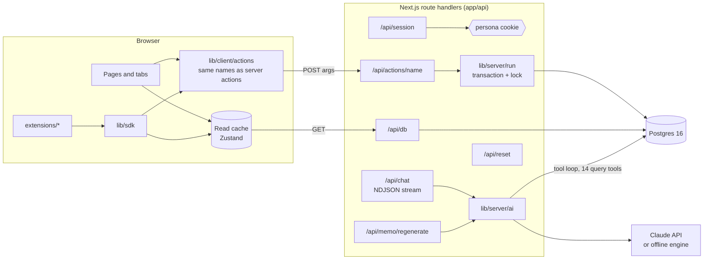
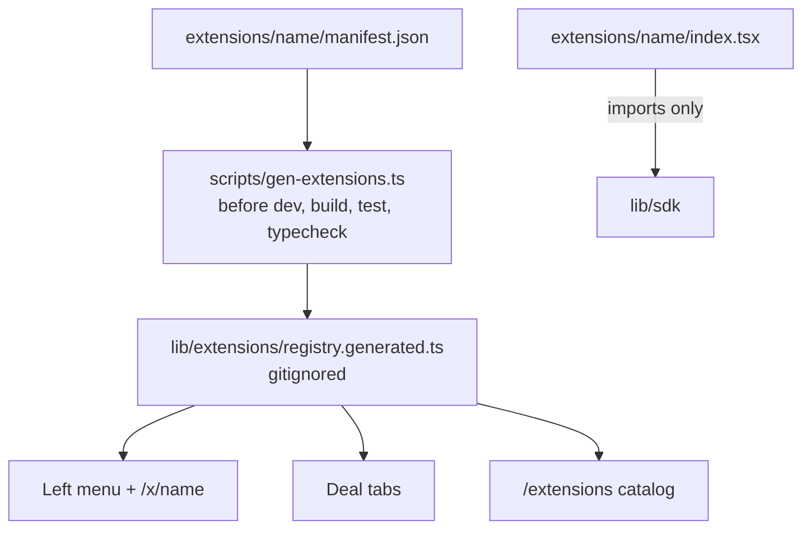
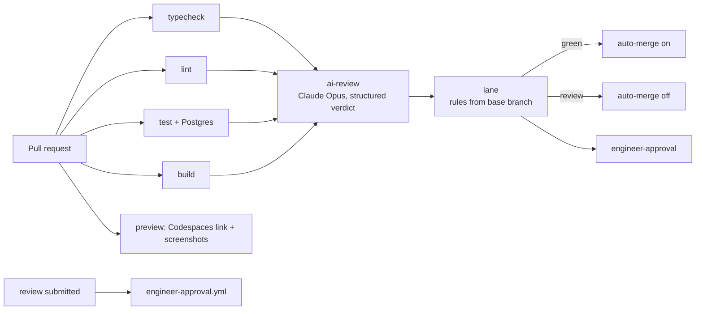

# Covenant architecture

How Covenant works now that it has a real backend and a citizen-developer pipeline. For the Task 1 prototype (all data in the browser), see [`SYSTEM.md`](SYSTEM.md) and tag `task1-v1`. Implementation choices are logged in [`decisions.md`](decisions.md).

## 1. The app

**One write, end to end.**
1. A component calls `moveStage(dealId, "ic")` from `lib/client/actions`, a thin wrapper that POSTs `{ args }` to `/api/actions/moveStage`.
2. The route reads the persona cookie (`lib/server/session.ts`), rejects unknown actions (an explicit registry in `lib/server/run.ts`), and calls `runAction`.
3. `runWithDB` opens a transaction, takes an advisory lock (writes are serialized), and loads the database into the app's `DB` shape (`lib/server/repo.ts`, which maps 30 normalized tables to 24 collections).
4. The action in `lib/actions.ts` runs unchanged from Task 1. It calls `commit()` (`lib/core/commit.ts`), which checks the role's permission (`lib/permissions.ts`), applies the change to a copy, and appends `AuditEvent`s.
5. `saveDiff` compares before and after and writes only the changed rows, including child tables (deal team, pages, covenant levels, votes, questions, mentions). Then it commits.
6. The route returns the action's result and the new database; the browser replaces its cache.

**Rules the database enforces on its own:** issued and locked term sets can't be edited (trigger, bypassed only by the seed transaction), and audit rows are append-only (trigger). Foreign keys are deferred, so one action's writes are checked together.

**Chat and memo AI run on the server.** `lib/server/ai.ts` runs Claude's tool loop against a snapshot (14 typed query tools in `lib/llm/query-tools.ts`), streams progress to the browser as newline-delimited JSON, and saves messages through the same write path. Without `ANTHROPIC_API_KEY`, the offline engine answers by running the same queries.

**Data and schema.** Migrations are plain SQL in `db/migrations/`, applied by `npm run db:migrate`. The demo data is `buildSeed()` (`lib/seed/`), loaded by `db:seed` / `db:reset` and by "Reset demo data". A database test proves the round trip is exact.

## 2. Extensions

- **Contract:** `lib/sdk/index.ts` is the only module an extension may import (plus React). It exposes `useCovenant()` (read-only collections and helpers such as `metrics(dealId)`), two writes (`addNote`, `addDiligenceItem`, both server actions), formatting, and shared components. It is documented for citizens in `lib/sdk/README.md`.
- **Discovery:** the generator validates each manifest (`lib/extensions/manifest.ts`) and writes the registry. Because the registry is generated and gitignored, a new extension changes only its own folder.
- **Isolation:** each extension renders inside an error boundary that names its owner. Static rules are enforced by ESLint (`eslint.config.mjs`); runtime safety comes from the server, since extensions can only call the two allowed actions and the server checks permissions.
- **Tests:** extension tests run in jsdom (a vitest project) with `renderExtension()` from `lib/sdk/testing`, which loads the demo data and records writes.

## 3. The citizen workspace and harness

- **Workspace:** `.devcontainer/` (Codespaces or VS Code Dev Containers) runs an app container (Node 22, GitHub CLI, Claude Code) and Postgres 16. It installs, migrates and seeds on create, and starts the app on every start (`start-preview.sh`, port 3000, "Covenant preview"). `node_modules` and `.next` are container volumes.
- **Harness:** `CLAUDE.md` (behaviour), `AGENTS.md` (the same rules for other tools), `.claude/settings.json` (model, allow, ask and deny rules), `.claude/hooks/guard-paths.mjs` (blocks edits outside `extensions/`; off when `COVENANT_ENGINEER=1`), and skills in `.claude/skills/` (new-extension, preview, ship-it).
- **Audit and cost:** `scripts/claude/cost.ts` estimates the session's cost from Claude Code's local transcript at list prices; `scripts/claude/audit.ts` produces the "AI-authored / Directed by / Model" block and commit trailers.

## 4. The pipeline

| Job | File | Blocks merging? |
|---|---|---|
| typecheck, lint, test, build | `.github/workflows/pr.yml` | Yes (required) |
| ai-review | `pr.yml` → `scripts/ci/post-ai-review.ts` | Required to finish; its verdict feeds the lane |
| lane | `pr.yml` → `scripts/ci/classify-pr.ts` (rules in `scripts/ci/lane.ts`) | Required to finish |
| engineer-approval | `pr.yml` and `engineer-approval.yml` → `scripts/ci/engineer-approval.ts` | Yes: passes for green; for review, only after an engineer approves the latest commit |
| preview | `.github/workflows/preview.yml` | No |
| metrics | `.github/workflows/metrics.yml` (weekly) | No |

**Who approves:** `.github/CODEOWNERS` (`*` engineers, `/extensions/` business approvers) with branch protection "require code owner review". `.github/approvers.json` mirrors it for the scripts.

**Trust boundaries.** The lane and engineer-approval jobs check out the *base* branch, so a pull request can't change the rules that judge it. Edits to `.github/`, `scripts/` or the harness always land in the review lane and need an engineer as code owner. The AI reviewer has read-only tools and treats the diff as data. Pull requests from forks get no secrets, so the AI review doesn't run and they fall into the review lane.

## 5. Where each rule is enforced

| Rule | Harness (advisory) | Static (CI) | Runtime | Approval |
|---|---|---|---|---|
| Change only one extension folder | Guard hook, CLAUDE.md | Lane classifier | n/a | Review lane → engineer |
| Use only the SDK; no network/storage/secrets | CLAUDE.md, skill | ESLint rule | Server permission checks | AI review |
| Only notes and diligence items written | SDK surface | ESLint (no other imports) | Action registry + permissions | AI review |
| Locked terms and audit are immutable | n/a | n/a | Postgres triggers | n/a |
| Tested before shipping | Skills | Structure test + test job | n/a | n/a |
| A named human approves | ship-it explains | n/a | n/a | CODEOWNERS, branch protection, engineer-approval |
