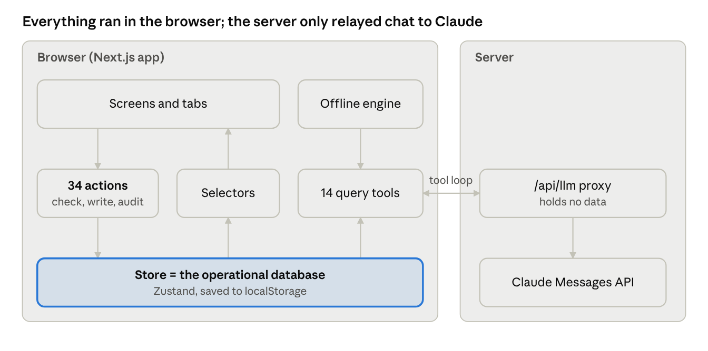

# Covenant: system explanation

Covenant is a working underwriting workspace for the deal team of a fictional private credit fund, Fernhill Credit Partners. On realistic, internally consistent data it runs the full path from a new CIM to an IC-approved, locked set of terms.

## 1. What I built

One workspace for deals, companies and people, with each deal's work in ten tabs ordered by the deal lifecycle.

| Area | What it does |
|---|---|
| **Deals** | List and pipeline board; dragging a deal runs the stage rules (missing items listed, overrides need a reason, Documentation needs IC approval). |
| **Financials** | AI-extracted values beside the source page, with confidence; a person confirms or corrects. Correcting LTM EBITDA from $17.5M to $16.3M moves leverage from 5.14x to 5.52x, cushion from 26.5% to 21.1%, and flags the affected memo sections. |
| **Securities** | Versioned term sets (draft, issue, compare), tranches, covenant schedule with headroom, sources and uses. IC approval locks the approved version. |
| **Due diligence** | Findings by workstream; a red flag becomes a proposed IC condition in one step, and unresolved red flags block the move to IC. |
| **IC memo** | Eight sections where every number is a live reference, never typed, so corrections can't leave stale figures. Only a VP or MD can mark it ready. |
| **IC and approvals** | Packet, votes, Q&A, conditions, decision; precedents from the fund's own past deals and devil's-advocate questions. |
| **Chat** | Questions across the whole database, answered with citations and a "Show queries" trace. |
| **Relationships** | Company and person pages with role history, sponsor track record, notes and duplicate checks. |

Four personas (Analyst, VP, MD, IC member) have enforced permissions, and every change lands in an audit trail.

## 2. Architecture

The prototype is a Next.js app. Data lived in the browser; the server only relayed chat to Claude.

- **The data model lives in code:** schema, 34 named actions (such as `correctField`, `issueTermSet`, `decideIc`) and selectors for derived values. The UI never writes data directly.
- **AI answers by querying, not searching files:** Claude gets 14 typed query tools that return compact results with citation tokens. In production these become an MCP server over Postgres.
- **It works without AI:** with no API key, chat runs the same queries and the memo uses deterministic templates.
- **Production path:** extraction with a human review queue, Postgres, SSO and information walls, CRM and data-room integrations, and a separate analytics warehouse.

Since Task 1, the app runs on a real Postgres backend behind the same actions (see [`ARCHITECTURE.md`](ARCHITECTURE.md); the prototype is tagged `task1-v1`).

## 3. Data model

24 entities, each validated; [`schema.sql`](schema.sql) is the Postgres equivalent.

- **Relationships:** Company, Person, Affiliation, Stakeholder, Note, User.
- **Underwriting:** Deal, StageEvent, Document, ExtractedField, FinancialPeriod, TermSet, Tranche, Covenant, DDItem, Memo, MemoSection, ICEvent, ICCondition, DevilsAdvocate.
- **Cross-cutting:** AuditEvent, ChatThread, ChatMessage, Settings.

Five rules hold throughout: numbers are computed from confirmed records, never typed; term sets are copy-on-write and locked at IC approval; every write produces an AuditEvent; risk ratings are stored with their scale; duplicate checks run before creating a company or person. The seed (12 deals, 25 companies, 40 people) ties out, and 69 unit tests check calculations, stage rules, permissions and seed integrity.

## 4. Tradeoffs

| | |
|---|---|
| **Mocked** | Sign-in (persona picker); CIM extraction (staged animation with pre-written values); documents are Markdown, not PDFs. |
| **Simplified** | Browser storage as the database (one user); four roles, not deal teams; one covenant type; simple precedent similarity. |
| **Skipped** | Information walls and MNPI controls, email and calendar capture, data-room sync, Word export, closing and post-close. |

## 5. With a couple more days

1. **Real extraction:** PDF upload, schema-driven extraction with confidence, and a firm-wide review queue.
2. **MCP server:** serve the 14 query tools over MCP, so Claude and other clients can query the fund's data directly.
3. **Financial modeling:** multi-year projections with base and downside cases, EBITDA add-backs, debt service and leverage paths over the hold, and returns (IRR, MOIC), all feeding covenant headroom; plus more covenant types.
4. **Closing:** checklist, conditions precedent, approved versus signed terms.
5. **Controls:** SSO, deal teams, information walls, Word export of the memo.
