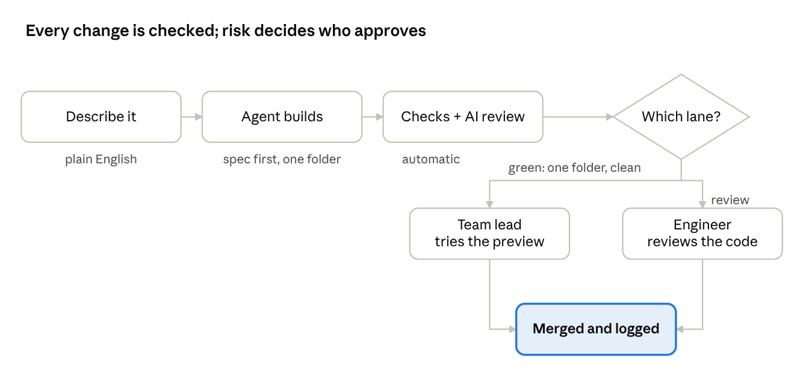

# A paved road for citizen developers

*How a credit fund can let its deal team build software with an AI coding agent, safely. Worked example: Covenant, the fund's underwriting app.*

## 1. The idea, in plain language

Deal teams want small tools, such as a deal one-pager or a sector-exposure view, but engineers are scarce. AI coding agents like Claude Code now let non-coders describe a screen and get working software. The question is how to allow it without risking the fund's data and numbers.

**A harness** steers the AI agent: written instructions, step-by-step routines, a list of allowed commands and a guard on protected files. It makes good behaviour the default.

**An SDLC** (software development lifecycle) is the path every change takes to go live: plan, build, test, review, approve, release, measure.

**Why both.** A harness runs on one person's laptop and can be switched off or talked around. The SDLC makes the rules binding: every change gets the same automatic checks, an AI review, a named human approver and a permanent record.

**Cost and quality.** Small, self-contained changes take the green lane: the team lead tries the screen and approves. Anything touching calculations, data or permissions takes the review lane to an engineer. Spend is capped per person and team, and everyone gets the best model, because rework costs more.

## 2. How it works: this repository as the example

Citizens work in one folder, `extensions/<name>/`: a manifest, a screen and a test. It reaches the app only through `lib/sdk`, an engineer-owned module offering read-only data, the app's own calculations and exactly two writes (add a note, add a diligence item). The core is out of reach. That small surface keeps the agent reliable, and lets a business approver judge a live preview rather than code.

*A change missing an AI verdict, or touching anything outside its folder, always goes to review.*

| Layer | Rule | Enforced by |
|---|---|---|
| Workspace | Codespace or local container; demo data, no secrets | `.devcontainer/` |
| Harness | Spec first (`SPEC.md`); edit only `extensions/` | `CLAUDE.md`, skills, `PreToolUse` hook (advisory) |
| Static | Import SDK + React only; no network, storage, secrets | ESLint rule |
| Runtime | Named, role-checked, audited writes; locked terms immutable | Server actions, Postgres triggers |
| CI | Typecheck, lint, tests on Postgres, build; Opus verdict none / minor / serious | GitHub Actions, `claude-code-action` |
| Lane | Green = one folder + checks pass + not serious; else review | Classifier, run from base branch |
| Approval | Green: business approver, never author → auto-merge. Review: engineer on latest commit | CODEOWNERS, branch protection, `engineer-approval` |
| Measure | Weekly: time to first change, lane mix, pass rate, reverts, cost | Scheduled workflow |

**Defence in depth.** No layer is trusted alone. The hook can be bypassed; ESLint can't. ESLint can be evaded; the reviewers read the code. Even a rogue extension can call only two permission-checked writes.

**Production would add** SSO, per-user data visibility, a deploy step after merge, sandboxed extensions and GitHub teams as approvers.

## 3. State of play

**What works.** Agents reliably build small, bounded features against a clear API with tests. GitHub CI, branch protection and code owners are mature and free. Cloud workspaces remove setup. Claude admins can cap spend by organisation, group and user, with alerts ([Anthropic, July 2026](https://claude.com/blog/giving-admins-more-visibility-and-control-over-claude-usage-and-spend)).

**What doesn't, yet.** Review is the bottleneck, hence a lane that spares engineers low-risk work. Non-coders can judge behaviour, not code. Laptop guardrails are advisory and per-change cost is an estimate. Orphaned apps are the long-run risk, hence named owners and an in-app catalogue.

**Who's doing it.**
- **Anthropic:** legal, marketing and design teams build their own tools with Claude Code ([source](https://www-cdn.anthropic.com/58284b19e702b49db9302d5b6f135ad8871e7658.pdf)).
- **Stripe:** agents open 1,300+ pull requests a week, all human-reviewed. Engineers, not citizens, but the same review-gated pattern ([InfoQ, March 2026](https://infoq.com/news/2026/03/stripe-autonomous-coding-agents/)).

**Tools and categories.**

| Category | Examples | Role here |
|---|---|---|
| Coding agents | Claude Code, Copilot agent, Codex, Cursor, Devin | Builder |
| Guardrails and spend | Claude Code hooks and managed settings; Claude admin controls | Harness, budget |
| Security scanning | CodeQL, Dependabot, Semgrep, Snyk | Next additions |
| Low-code | Power Apps, Retool, OutSystems | Alternative; separate stack |
| Dev environments | Codespaces, Dev Containers, Ona, Coder | Workspace |

This sits between low-code and full engineering: the deal team builds inside the real app, with review scaled to each change's risk.
